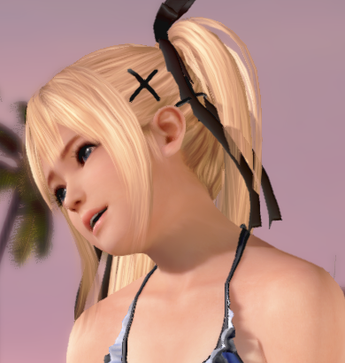
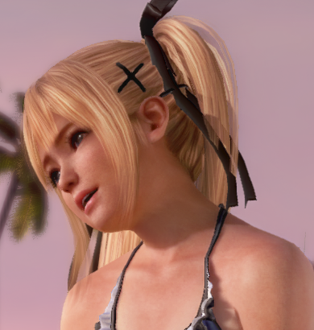
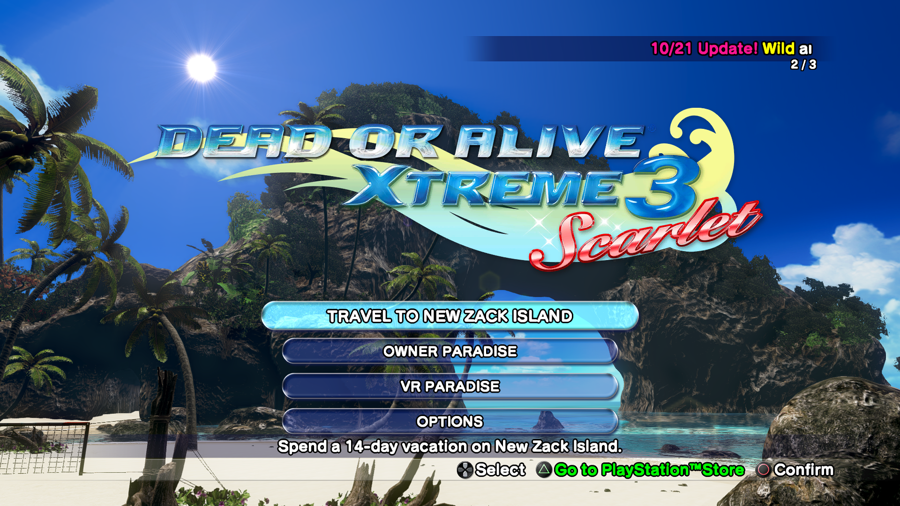
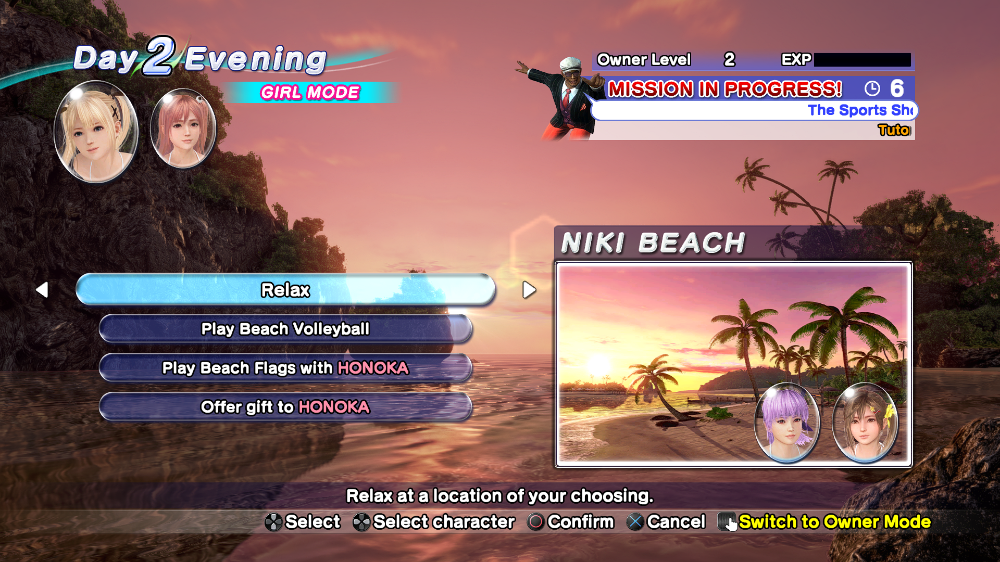

# DOAX3 Scarlet PC

Experimental Windows x64/Vulkan port of **Dead or Alive Xtreme 3 Scarlet**,
targeting **CUSA14173, version 01.08**. Original x86-64 guest code runs through
the inherited native runtime; the shadPS4 graphics core translates GPU commands
and shaders to Vulkan.

This repository contains source, portable launch/build
tools, documentation and selected smoke-test screenshots. **Build the host before
running.** Game packages/data, firmware, compiled game images, saves, shader
caches, proprietary DLSS DLLs and the DLSS SDK are supplied separately.

Validated scenes include the rotating title island/menu and animated Relax
scenes, including native neural rendering with depth and camera/object motion.
The async shader retention/permutation fixes are included. Full-game activity,
DLC and every island-camera angle coverage remain incomplete; occasional black
background reports outside the captured routes are not declared fully resolved.

## What you need

| Input | Requirement |
|---|---|
| Base game |Scarlet **CUSA14173**, matching region/title; extracted plaintext data|
| Update |Matching **01.08** update, overlaid onto the base; required for this tested profile|
| DLC |Optional matching CUSA14173 packs; place each extracted pack under addcont/CONTENT_LABEL/|
| System modules |libSceFiber.sprx, ulobjmgr.sprx, libSceUlt.sprx in sys_modules/ or a configured folder|
| PC build |Windows x64, Python 3.11+, MSYS2 CLANG64 and Vulkan driver|
| Optional NR |Compatible NVIDIA hardware/runtime plus the four-file adapter/runtime layout below|

Use your own game/system-module files. The launcher accepts an **extracted game
folder**, not a PKG directly; encrypted/compressed SELF segments are unsupported.
[Package identities, hashes and assembly instructions](docs/game-files.md)
describe exactly which base/update were used. DLC is not required to build or
launch the base+update profile.

## Build and run

1. Install the [build dependencies](docs/building.md).
2. Clone this repository and build from its root:

```powershell
git -c core.longpaths=true clone https://github.com/negroISO/doax3-scarlet-pc.git
cd doax3-scarlet-pc
.\Build.cmd -MSYS2Root C:\msys64 -Jobs 4
```

3. Extract/merge your matching base+update and supply the three system modules.
   Configure their locations on the first launch:

```powershell
.\Launch-DOAX3-Scarlet.cmd --game-dir ".\game\CUSA14173" --modules-dir ".\sys_modules" --msys2-root C:\msys64
```

The paths are remembered in ignored local.json. Subsequent starts only need:

```powershell
.\Launch-DOAX3-Scarlet.cmd
```

For a fresh machine, see the [clean-checkout checklist](docs/portability.md).
PKGs need separate extraction; the compiler, Vulkan driver and three system
modules are also required. No private server, other game-port checkout or
existing save/cache is needed.

Use **Launch-DOAX3-Scarlet-NR.cmd** only after completing the optional
[neural-rendering setup](docs/neural-rendering.md). Both launchers use this
repository's user/ saves and persistent cache, native 1920×1080, async shaders,
30 FPS cap and 60 Hz guest vblank. **No frame generation.** A different scene or
draw-state combination can still compile on first use.

## Where the optional DLSS5/NR files go

The native path needs no neural DLLs. For the tested optional Feature 18 path:

```text
source/out/gpu/
  theorder-probe.exe
  port_dlss.dll
  nvngx_dlss.dll
  nvngx_dlssnr.dll
  nvngx.dll/port_nr.dll       # nvngx.dll is a directory
```

Build the two port adapters from the included bridge source, then stage your
compatible runtime DLLs with tools/Stage-Neural.py.
[Full build/staging instructions and tested hashes](docs/neural-rendering.md).
Copying the VAM BepInEx plugin into this native application is not required.

## Controls and local data

- Circle / confirm: Left Shift or Esc; Cross: Space or Enter.
- Options / skip movie: F8; controller Options/Start is also supported.
- Left stick: WASD; right stick/camera: arrows; d-pad: I/K/J/L.
- Controller input uses SDL3. Saves/settings/cache live in user/; run logs and
  regenerated linked images live in runtime/. Keep Fortune and Scarlet saves
  in their separate repositories; there is no automatic cross-edition migration.
- Back up user/ before changing builds. No saved game is included in Git.

## Validation and limits

The Scarlet branding smoke tests measured 29.974FPS for a 120-second native
title/menu run and 29.963 FPS for a 220-second NR Relax run on the RTX 5090.
These are short scene tests, not whole-game or Steam Deck performance claims.

See [validation.md](docs/validation.md) for evidence and limits.
Remaining work includes complete GS streamout/COPY_DATA/water effects,
exhaustive outfits/maps/Photo Paradise and broader activity testing. Sound
playback was not verified in the latest session without a default audio device.
Native Linux / Steam Deck packages and a graphical installer are described in
[Steam Deck setup](docs/steamdeck.md). Actual Deck gameplay remains unverified.

## Native / DLSS5 NR comparisons

Same-frame comparison from the experimental [Feature 18 NR integration](docs/neural-rendering.md),
at native **1920×1080**, default NR strength **1**, with depth and camera/object-motion
guides and **no frame generation**. Left: the native scene immediately before
NR. Right: that exact frame after NR, before UI composition. These are paired
render buffers, rather than separate NR-off/on playthroughs.

**Poolside Relax — face, hair and shoulder detail** (390×410 source-pixel crop):

| Native scene / NR input | NR output |
|---|---|
|  |  |

[Full-resolution pair, capture record and reproduction steps](docs/nr-comparisons.md).
The PNGs and identical crops have no resizing, sharpening, color grading or
generative editing. NR changes lighting and can reinterpret facial/skin detail;
these stills show its output, not proof of recovered original texture detail or
temporal stability. Open the linked originals to inspect at 100% pixel scale.
For Rock Climbing and another pool-camera face close-up, see the
[Fortune comparisons](https://github.com/negroISO/doax3-fortune-pc/blob/main/docs/nr-comparisons.md).

## Earlier smoke-test screenshots



Scarlet1.08 native title/menu, smoke run scarlet-108-branding-native-1.



Evening beach/menu from scarlet-108-nr-native-object-vacation-1, with NR and
object-motion guides enabled. Original smoke captures, not promotional renders.

## Source and licensing

This edition and the separate [DOAX3 Fortune repository](https://github.com/negroISO/doax3-fortune-pc)
start from the same recorded shared runtime snapshot. The editions differ in
profile, launchers, required game data and validation evidence. The root launch
tools replace machine-specific development paths; archived source documentation
is retained as historical reference.

[Provenance, revision pins and full credits](docs/provenance.md) distinguish
direct DOAX3 work from inherited port ancestry. The main source inherits
[GPLv2](LICENSE); dependency and MIT bridge notices remain in their own files.
Game content shown in screenshots remains the property of its rights holders.

## Special thanks

- [Supermedo — Uncharted: The Nathan Drake Collection](https://github.com/Supermedo/uncharted_pc)
  and [Mateus Meneses — The Order: 1886 port](https://github.com/mateussmeneses/theorder1886-port)
  for the earlier porting work, runtime references and shared integration/toolchain work.
- The inherited chain: [Felipe Prado / God of War III (SpartanPort)](https://github.com/FelipePrado0/SpartanPort),
  [Supermedo / Bloodborne Windows](https://github.com/Supermedo/bloodborne_pc),
  [deadinside28 / Bloodborne](https://github.com/deadinside28/bloodborne_pc),
  [cuesta4](https://github.com/cuesta4/shadPS4/tree/eltutz) and the
  [shadPS4 team](https://github.com/shadps4-emu/shadPS4).
- [IFreemz / eFMann](https://github.com/eFMann/shadPS4-Bloodborne-DLSS-FSR)
  for the DLSS bridge foundation; the VamDlssNr integration reference for the
  compatible optional NR runtime reference.
- [FSR-Vulkan](https://github.com/FireBurn/FSR-Vulkan), AMD FidelityFX,
  [NVIDIA DLSS SDK](https://github.com/NVIDIA/DLSS), Mesa, Khronos, SDL3,
  FFmpeg, LibAtrac9 and the other dependency authors listed in
  [provenance and full credits](docs/provenance.md).
- Team NINJA / Koei Tecmo for the original games. This unofficial project is
  not affiliated with or endorsed by the game or hardware companies.
