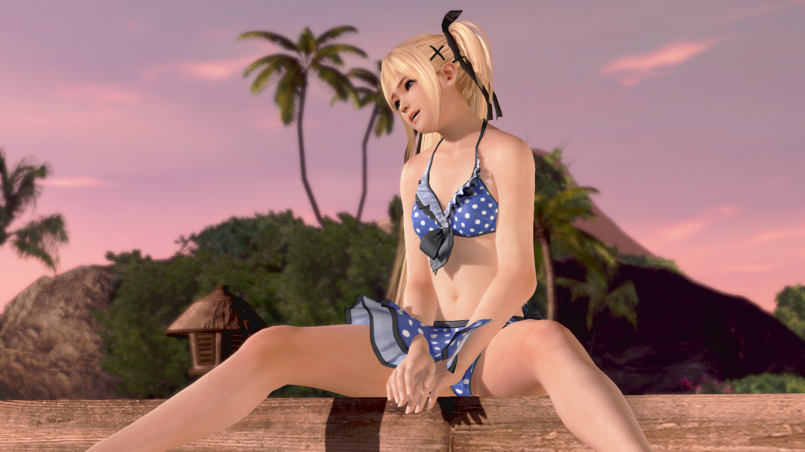
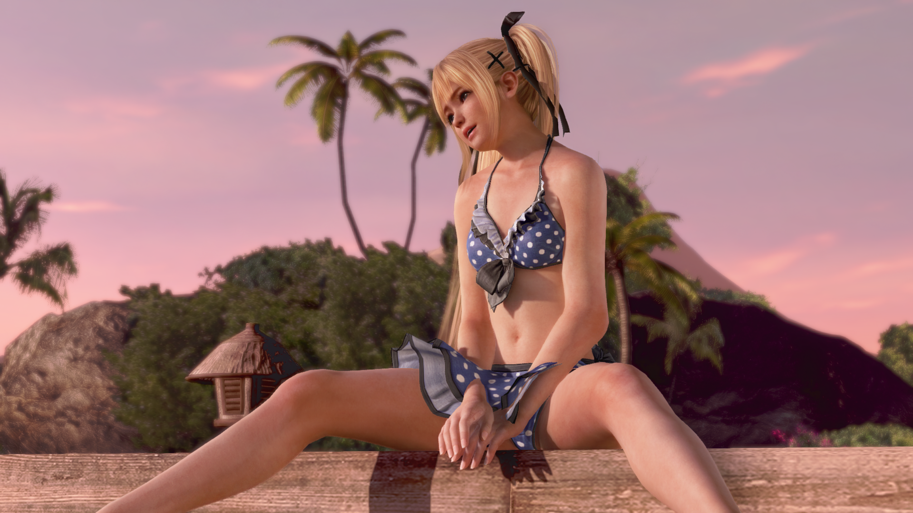

# Scarlet: native scene / NR comparison

These are actual game render buffers from Scarlet **CUSA14173 01.08** on an
RTX 5090. The experimental Feature 18 integration is the path called the
“DLSS5 mod” in this project; see [setup and tested runtime hashes](neural-rendering.md).
This example uses 1920×1080 color, depth and camera/object-motion guides,
default NR strength 1 and a 30 FPS cap. Frame generation is disabled.

## Poolside Relax portrait

Smoke run `scarlet-108-nr-native-warm-character-1`, started
**2026-10-26 00:12:17 UTC**; pair `nr_001`, requested 210 seconds after launch.
This is an earlier validated development-host capture, not a new run of the
repository's rebuilt executable. Exact host, guest and adapter/runtime hashes
are recorded in the linked capture record. The scene is Poolside Relax,
rather than Photo Paradise.

| Native scene / NR input | Same frame after NR |
|---|---|
|  |  |

| Native face / hair / shoulder detail | NR face / hair / shoulder detail |
|---|---|
|  |  |

Identical crop: `(880, 30)` to `(1270, 440)`, 390×410 source pixels.
[Capture provenance, raw/PNG hashes and settings](screenshots/comparisons/poolside-relax/capture.json).
The visible differences include darker facial shading, fine skin texture and
changes to hair detail. NR can also change the appearance of facial features.

## How the pair was made

The capture hook in
[vk_doax3_neural.cpp](../source/gpu/shadps4/video_core/renderer_vulkan/vk_doax3_neural.cpp)
copies scene color immediately before and after the in-place NR evaluation.
The images therefore have the same animation time, pose, camera and exposure
input. They precede UI composition. “Native” means the input scene buffer;
it is not a separately launched NR-disabled session or its temporal history.

The legacy raw filenames say `rgba8`, but this VideoOut path stores **BGRA8**.
The exporter decodes that byte order to lossless RGB PNG and applies the same
integer crop to each side. It adds no resampling, sharpening, retouching or
color grading. GitHub may scale previews; open/download each PNG for 100% inspection.

To export your own already-recorded pair, install the optional documentation
dependencies and use the included helper (the raw captures are not distributed):

```powershell
python -m pip install Pillow numpy
python tools/Export-NR-Comparison.py --capture "C:/Captures/my-run" --prefix nr_001 --name my-relax-comparison --description "My matched Relax portrait pair" --crop face:880,30,1270,440
```

The capture directory must contain the two raw buffers, `run.json` and
`stdout.log` from an NR-enabled run. The exporter rejects identical buffers and
runs without successful NR log evidence; it refuses to overwrite an existing
comparison directory. Each `capture.json` includes source/output hashes,
settings and crop coordinates, without local machine paths or DLL payloads.

The pixel-difference values are sanity checks, not quality scores. NR can
relight and reinterpret detail; added skin texture is not proof of original
game texture recovery. Static pairs do not establish flicker, ghosting or
temporal stability. Existing water/streamout limitations still apply.

See the [Fortune comparisons](https://github.com/negroISO/doax3-fortune-pc/blob/main/docs/nr-comparisons.md)
for Rock Climbing and another pool-camera face close-up.
